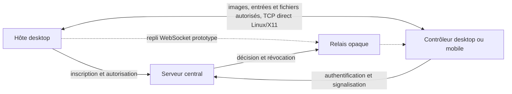

# Architecture et périmètre

Cette page sert de carte de conception ; elle ne certifie pas que tous les blocs sont présents dans le code actuel. Le [README](../README.md) et l'[état des fonctionnalités](status.md) indiquent ce qui est exécutable.

## Workspace actuel

| Composant | État dans cette première tranche |
| --- | --- |
| `crates/protocol` | Contrats de messages et grants de session signés, vérifiables côté hôte. |
| `crates/transfer` | Primitives de transfert différé, blocs et intégrité, raccordées au transfert manuel contrôleur → hôte du prototype Linux/X11 ; aucun presse-papiers natif. |
| `apps/server` | Binaire central avec initialisation, contrôle des données, API et panel intégré. |
| `apps/desktop` | Binaires en ligne de commande `cyclar-host` et `cyclar-desktop`, avec capture, fenêtre de contrôle et entrées Linux/X11 via connexion TCP directe chiffrée. Aucun backend desktop Windows/macOS n'est livré. |

Ce découpage évite de créer des crates sans frontière stable.

## Quatre rôles produits visés

| Rôle | Responsabilité cible |
| --- | --- |
| Serveur central | Identité, autorisations, présence, rendez-vous réseau, relais opaque et administration. |
| Hôte léger desktop | Présenter un ID et un secret, accepter un contrôle autorisé. |
| Application desktop complète | Héberger et contrôler des postes, avec compte facultatif. |
| Client mobile | Contrôler un desktop ; aucune fonction d'hôte mobile. |

Le serveur reste l'autorité d'une nouvelle session, y compris quand son flux de données passe directement entre deux machines. Le chemin de contrôle traite les comptes, droits et invitations ; le chemin de données du prototype transporte images, entrées et, si le transfert manuel est activé, des fichiers entre hôte et contrôleur. Le client tente d'abord le TCP direct, puis un relais WebSocket qui achemine les octets du canal Noise sans les déchiffrer. Ce repli a été testé sur boucle locale ; le WSS public, le NAT et la qualité sous charge restent à qualifier. Les droits sont vérifiés par le grant signé et des baux courts ; la qualification de révocation et d'endurance reste à mener.

Les frontières stables du code doivent séparer modèle/protocole, politique d'accès, stockage et interface. Les adaptateurs OS annoncent explicitement leurs capacités. Le chemin logiciel CPU est une capacité produit à maintenir, et l'accélération GPU ne doit être annoncée que sur des matériels qualifiés. Les décisions d'architecture majeures doivent être étayées par un test ou une mesure reproductible et documentées avant généralisation.

Le chemin Linux/X11 actuel convertit des images de l'écran en JPEG sur CPU, à cadence limitée, puis les envoie sur un canal direct authentifié. Il exige un serveur X11 avec visuel TrueColor 24 bits et pixels 32 bits little-endian ; XTest est requis pour l'injection d'entrées. Cette implémentation ne démontre ni support Wayland ni optimisation GPU, haute fréquence ou fonctionnement à travers NAT. Le [guide Linux/X11](desktop-linux-x11.md) détaille les essais possibles.

La cible « full Rust » concerne le code applicatif. Les API natives, codecs matériels, pilotes, magasins mobiles et signatures OS restent des dépendances des plateformes ; des adaptateurs minimaux peuvent être nécessaires. L'[état des fonctionnalités](status.md) et le [guide de validation](testing.md) précisent les capacités disponibles et les essais encore nécessaires.
